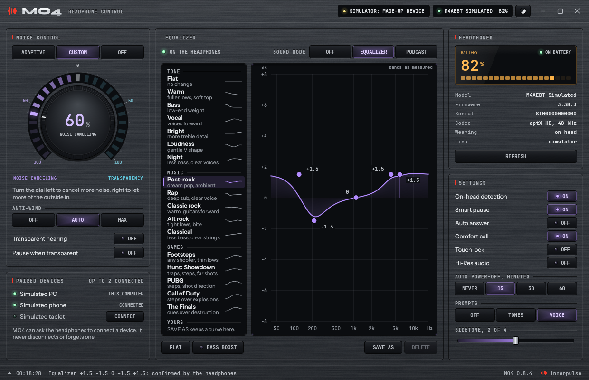
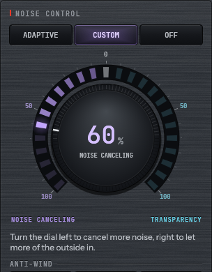
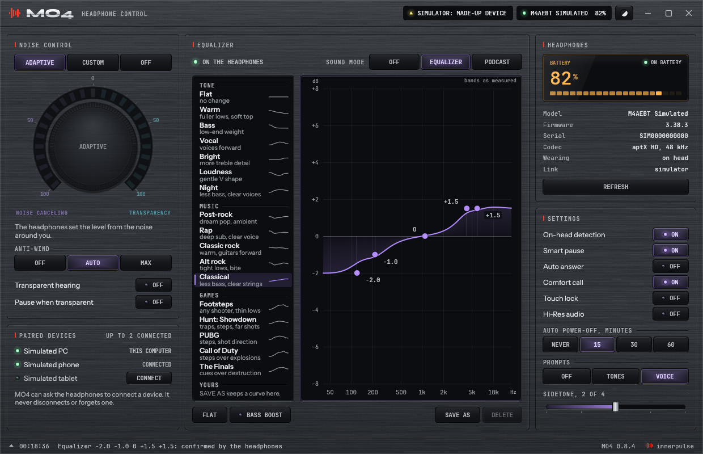
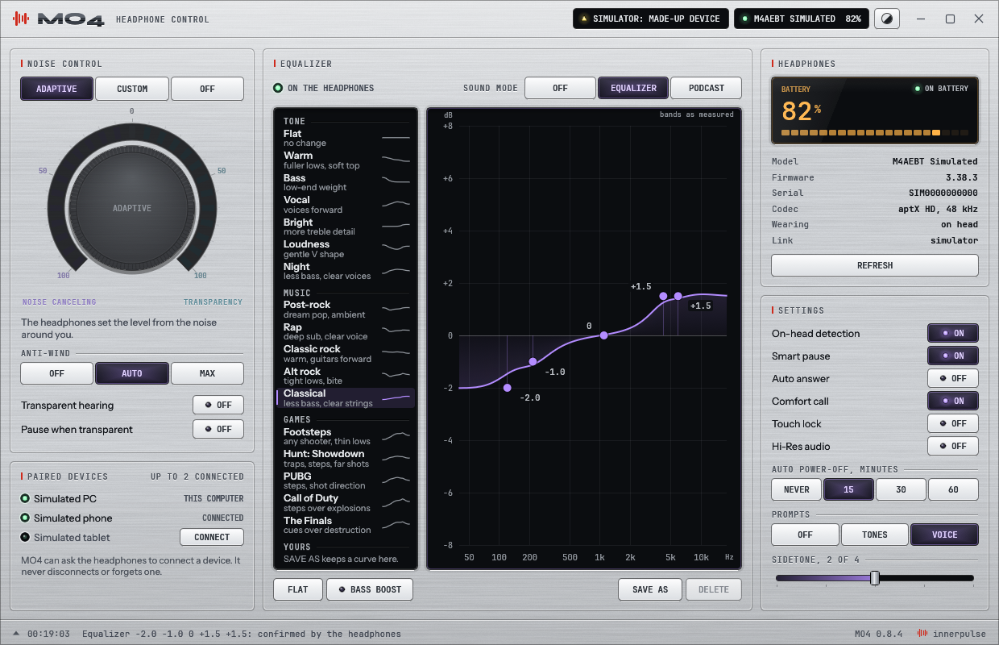
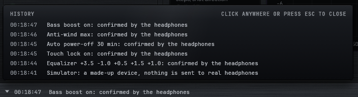
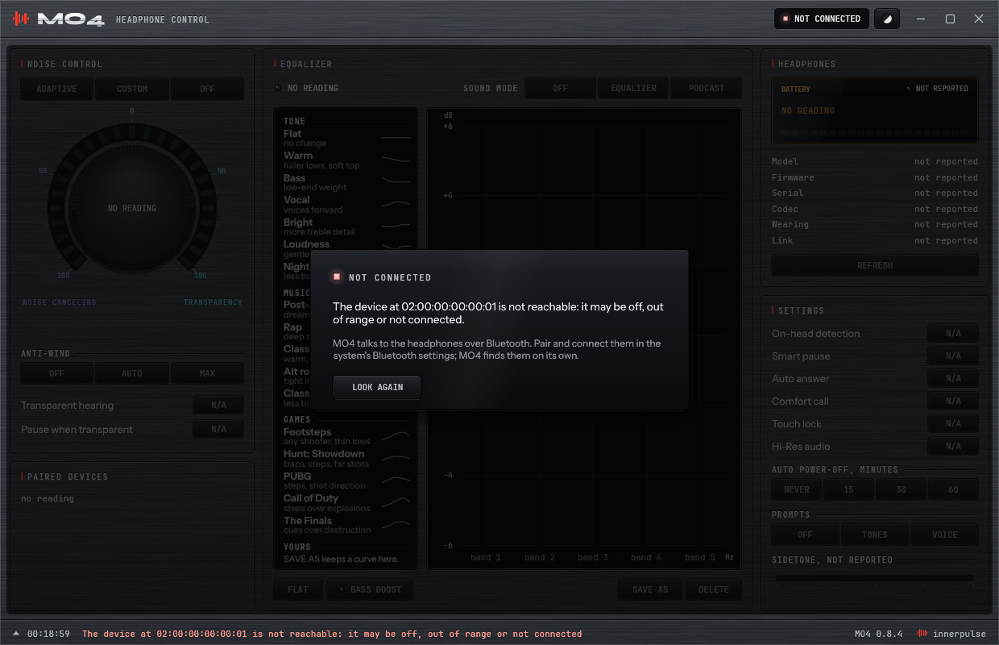
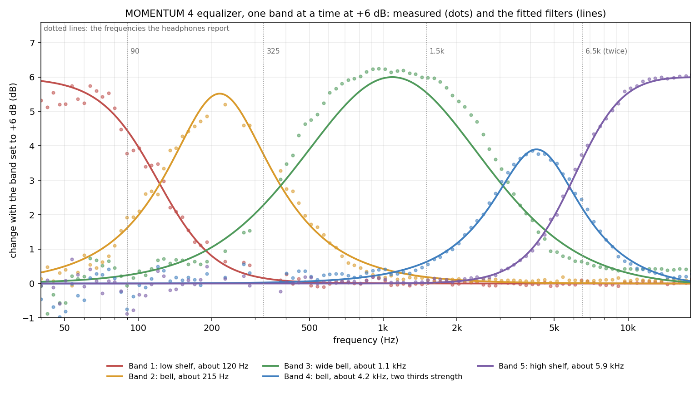

# MO4

A small desktop app for Linux and Windows 11 that controls **Sennheiser MOMENTUM 4**
headphones: noise control, the equalizer and the settings that otherwise only the phone
app can reach. It is one self-contained program written in Rust, with no driver and no
account. Everything it changes is stored on the headphones, so it keeps working after
you close the app.



MO4 is unofficial. It is not affiliated with Sennheiser or Sonova, and it talks to the
headphones with a protocol nobody published (see [how it was worked out](docs/PROTOCOL.md)).
Use it at your own risk.

## Status

| | |
|---|---|
| **Linux** | Works on real headphones: an M4AEBT SE on firmware 3.38.3, over an Intel AX200. Every setting reads correctly, and the changes tried so far were confirmed by the headphones. |
| **Windows 11** | Builds and passes its tests on GitHub. It has not been run against headphones yet, so treat it as untested. |
| **Other models** | Untested. Other recent Sennheiser headphones offer the same control service, so MO4 may connect to them, but nothing is known to work. |
| **Firmware** | The equalizer needs firmware 3.18 or newer. |

The screenshots on this page show the built-in simulator, a made-up headset used for
testing, which the titlebar labels as such.

## What it does

### Noise control



- **Adaptive, Custom or Off.** In Adaptive the headphones set the level themselves.
- **One dial in Custom**, from full noise canceling through neutral to full
  transparency. Drag it, scroll, or use the arrow keys; double-click for neutral.
- **Anti-wind:** off, auto or max.
- **Transparent hearing**, and pausing playback while it is on.

<br clear="right">

### Equalizer

The headphones' own five-band equalizer, edited on a graph of what it does to the
sound.

- The curve is the frequency response from 40 Hz to 18 kHz: what the five bands add
  up to, worked out from a [measurement](#what-the-curves-rest-on) of each band.
- Each node stands at its band's frequency, at the gain set on that band. Node and
  curve part ways where a band gives less than is set or its neighbors add to it.
- Point at a node to see that band's own share of the curve, what kind of filter it
  is, and what the headphones call it.
- Drag a node, scroll over a band, or use the arrow keys. Steps are half a dB, a tenth
  with Shift held. Double-click a node to zero it.
- A lamp says whether the curve is on the headphones, and what the headphones hold is
  drawn dashed behind your edit until the two agree.
- **Presets** in three groups, plus your own with SAVE AS.
- **Bass boost**, and the **sound mode**: off, equalizer or podcast. The curve is only
  heard in equalizer mode, so editing it switches the mode on.



### Settings and readings

- On-head detection, smart pause, auto answer, comfort call, touch lock, auto
  power-off, voice prompts and sidetone.
- **Paired devices**, which of them is this computer, and how many may be connected
  at once. A CONNECT key asks the headphones to connect to one that is not; it takes
  a second press, and the headphones may move to that device's audio. MO4 never
  disconnects or forgets a device.
- Hi-Res audio (24-bit/96 kHz over aptX Adaptive), which takes a second press to
  switch on because it changes what the audio link may carry. It only makes a
  difference when the computer or phone can send aptX Adaptive.
- Battery and charging, model, firmware, serial number, the codec in use with its
  sample rate, and whether the headphones are being worn.

### Two plates



The window is one plate of brushed metal with dark screens let into it, and it comes in
brushed steel or bare aluminum. The key with the two-tone disc in the titlebar changes
the plate, and MO4 remembers the choice. Screens, lamps and lit keys are the same on
both: only the metal changes, and what is written on it.

### Nothing is guessed

Every value on screen is one the headphones reported, with one exception that the
screen marks: the equalizer's curve is worked out from the gains they report and a
[measurement](#what-the-curves-rest-on) of what each band does. A setting the headphones did not report
shows as N/A or "not reported". After each change the app reads the value back and says
whether the headphones confirmed it. The line at the bottom shows what happened last;
click it for the history.



Without headphones the window says why, and draws no readings at all:



Every control can be reached with Tab and worked from the keyboard, and the app follows
the reduced-motion setting of KDE and of Windows.

## Presets

Gains are in dB for the five bands, lowest first. On these headphones the bands are a
low shelf below about 120 Hz, bells at 215 Hz, 1.1 kHz and 4.2 kHz, and a high shelf
above about 5.9 kHz. That is measured; it is not what the headphones report, which is
90 Hz, 325 Hz, 1.5 kHz and 6.5 kHz twice.

| Group | Preset | Curve | For |
|---|---|---|---|
| Tone | Flat | 0 0 0 0 0 | no change |
| Tone | Warm | +3.0 +1.5 0 -1.5 -1.5 | fuller lows, a softer top |
| Tone | Bass | +5.0 +1.0 0 0 0 | low-end weight |
| Tone | Vocal | -2.0 0 +2.5 +2.0 0 | voices forward, sibilance left alone |
| Tone | Bright | 0 0 0 +2.0 +2.0 | more treble detail |
| Tone | Loudness | +4.0 +1.0 -1.0 +2.5 +2.5 | a gentle V for low volume |
| Tone | Night | -3.0 0 +1.5 +1.0 0 | less bass, clear voices |
| Music | Post-rock | +1.5 -1.5 0 +1.5 +1.5 | post-rock, dream pop, ambient electronica: depth for pads, a clear wash, a lifted top |
| Music | Rap | +3.5 -1.0 +0.5 +1.5 +1.0 | sub-bass weight with the voice kept in front |
| Music | Classic rock | +2.0 +1.0 +1.5 +1.0 0 | body and warmth, guitars forward, the top left alone |
| Music | Alt rock | +2.5 -1.5 +0.5 +3.0 +1.0 | tight punch, less mud, guitar bite |
| Music | Classical | -2.0 -1.0 0 +1.5 +1.5 | less of the stock bass lift, clear strings |
| Games | Footsteps | -4.0 -1.5 +2.5 +4.0 +0.5 | any shooter without a curve of its own |
| Games | Hunt: Showdown | -2.0 +0.5 +2.0 +1.5 0 | the gentlest: sound traps, steps on every surface, how far off a shot was |
| Games | PUBG | -2.5 +1.0 +3.0 +2.0 0 | heavy steps and the direction of a shot, less vehicle rumble |
| Games | Call of Duty | -4.5 -2.0 +2.0 +5.0 +1.0 | the strongest: steps over explosions and streaks |
| Games | The Finals | -3.5 -1.0 +2.5 +3.5 +0.5 | steps and gadgets over collapsing buildings |

The shapes of the bands are measured; the taste is not. These are starting points by
ear and by reasoning. They assume the bass-forward tuning reviewers agree these
headphones have, so they add less bass than a curve for a neutral headphone would.
Change them to taste and keep your own.

### What the curves rest on

The headphones report a frequency for each band, but that is not where the bands act.
So they were measured: the headphones played noise into a microphone with one band at
a time moved, and the change from the flat curve was fitted with standard filters.



| Band | Reported | Measured |
|---|---|---|
| 1 | 90 Hz | a low shelf, half its effect at about 120 Hz |
| 2 | 325 Hz | a bell at about 215 Hz |
| 3 | 1.5 kHz | a wide bell at about 1.1 kHz, felt from 400 Hz to 3 kHz |
| 4 | 6.5 kHz | a bell at about 4.2 kHz that gives two thirds of what is set: +6 dB makes +3.9 |
| 5 | 6.5 kHz | a high shelf, half its effect at about 5.9 kHz |

- The bands add up. Two whole presets were recorded as a check, and both came out
  within half a dB of what the five filters predict.
- The headphones turn everything down by 1 to 4 dB when a curve boosts, and up a
  little when it cuts. A boost never sounds as loud as its number.

What this is worth: one pair of M4AEBT SE on firmware 3.38.3 and one microphone
position, with nothing measured below 40 Hz, so the lowest band could also be a very
wide bell near 50 Hz (from 40 Hz up the two are the same). MO4 uses these figures only
for headphones of that model that report that band layout, and marks the graph "bands
as measured" when it does; for anything else the graph is five evenly spaced nodes
under the frequencies the headphones report. The curve shows the shape of a setting,
not the drop in overall level that comes with a boost. The method and the numbers are in
[docs/PROTOCOL.md](docs/PROTOCOL.md#what-the-bands-do).

The game curves share one idea. Rumble masks the quiet sounds that give a position
away, and these headphones add bass of their own, so the low shelf comes down; steps,
reloads and the cues that place a sound sit from about 1 to 5 kHz, so the 1.1 kHz and
4.2 kHz bells come up. The 4.2 kHz bell gives two thirds of what is set, which is why
its numbers are the largest. The top shelf stays low: raising it lifts hiss and the
crack of every shot more than it lifts steps. How far each curve goes follows the
game's mix. Published advice on which frequencies carry footsteps disagrees from guide
to guide, and no equalizer adds positional cues a game did not mix in: use the game's
own headphone mode, and don't put a second virtual-surround layer on top of it.

## Install

Packages are on the [releases page](https://github.com/innerpulsenet/mo4/releases).

- **Debian or Ubuntu:** `sudo apt install ./mo4_<version>_amd64.deb`
- **Other Linux:** unpack `mo4-<version>-linux-x64.tar.gz` and run `linux/install.sh`,
  which installs for your user only.
- **Windows 11:** unzip `mo4-<version>-windows-x64.zip` and run `mo4.exe`. There is no
  installer. Windows may warn about an unsigned program.

## Connecting

Control goes over **Bluetooth**. Pair and connect the headphones in the system's
Bluetooth settings as usual; MO4 finds them on its own and never pairs anything itself.

Over a USB cable the headphones are only a sound card as far as MO4 is concerned: the
cable has a control channel of its own that does not speak this protocol. The window
does notice the cable. With no Bluetooth link it says the headphones are on USB, and
whether they are switched on or off and charging, and that nothing can be read or
changed that way.

The phone app uses the same channel. Close it if MO4 cannot connect.

### First run

Start with something that only reads:

```
mo4 status --trace
```

It prints each frame sent and received, then everything the headphones report. If that
works, the window will too. If it fails, the trace is what to put in a bug report: it
starts with the version of MO4 that made it (and it includes the serial number, which
you may want to remove).

## Command line

```
mo4                         open the window
mo4 status                  everything the headphones report
mo4 get <setting>           one value
mo4 set <setting> <value>   change a setting and confirm it
mo4 eq                      the equalizer curve
mo4 eq 2 0 -1 1.5 3         set every band, in dB
mo4 eq classic rock         apply a preset by name
mo4 presets                 list presets
mo4 connect <name>          have the headphones connect to a paired device
mo4 watch                   print changes as the headphones report them
mo4 help                    the settings and their values
```

Options: `--addr AA:BB:CC:DD:EE:FF` to use one device instead of searching,
`--channel N` to name the RFCOMM channel (Linux), `--trace` to print every frame,
`--sim` to talk to the built-in simulated headset, `--look steel` or `--look aluminum`
to open the window on that plate for one run, and `--version` to print the version and
the commit it was built from. The window shows the version at the bottom right.

## What it will not do

Some commands the headphones accept are destructive, and MO4 refuses to send them from
anywhere in the program: factory reset, firmware upgrade, forgetting or disconnecting
paired devices (which wiped the pairing on some firmware), and remapping the touch
surface. It also opens only the channels the headphones list for their control service;
sending control frames to other channels has been reported to switch the headset off.

Not there yet: a tray icon, the equalizer of firmware older than 3.18, renaming the
headphones, sound personalization (left as the phone app set it), and screen reader
support.

## Build

```
cargo build --release
```

Rust 1.88 or newer. On Linux, `linux/install.sh` copies the program to `~/.local/bin`
and adds a menu entry, and `linux/package-deb.sh` makes the `.deb`. On Windows, build
on Windows: `cargo build --release` gives `target\release\mo4.exe`.

`cargo test` runs the protocol, client and command line tests against the simulator
and against frames captured from real headphones. GitHub builds and packages both
platforms on every push, and publishes a release when a version tag is pushed.

Your presets are kept as plain text in `presets.txt`, and the choice of plate in
`look.txt`: in `~/.config/mo4/` on Linux and next to the exe on Windows.

## Credits

The protocol knowledge comes from
[galen/momentumctl](https://codeberg.org/galen/momentumctl),
[Oein/sennheiser-desktop-client](https://github.com/Oein/sennheiser-desktop-client),
[xndbogdan/sennheiser-control](https://github.com/xndbogdan/sennheiser-control),
[Ariazonaa/momentum-control](https://github.com/Ariazonaa/momentum-control),
[mislavperi/momentum-control](https://github.com/mislavperi/momentum-control) and
[f3Y0/momentum4-control](https://github.com/f3y0/momentum4-control). MO4 shares no code
with them.

Fonts: Instrument Sans, JetBrains Mono and Syne, under the SIL Open Font License
(`assets/fonts`). Sennheiser and MOMENTUM are trademarks of their owners, used here only
to say what the app works with.

## License

MIT: see [LICENSE](LICENSE). The bundled fonts keep their own license, the SIL Open
Font License, in `assets/fonts`.
